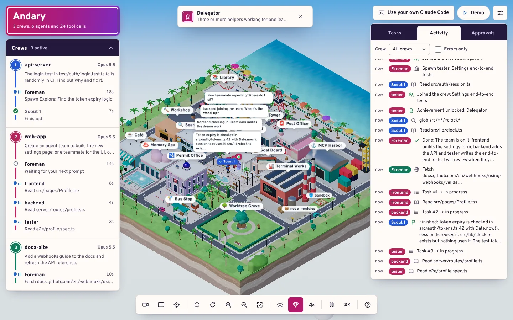
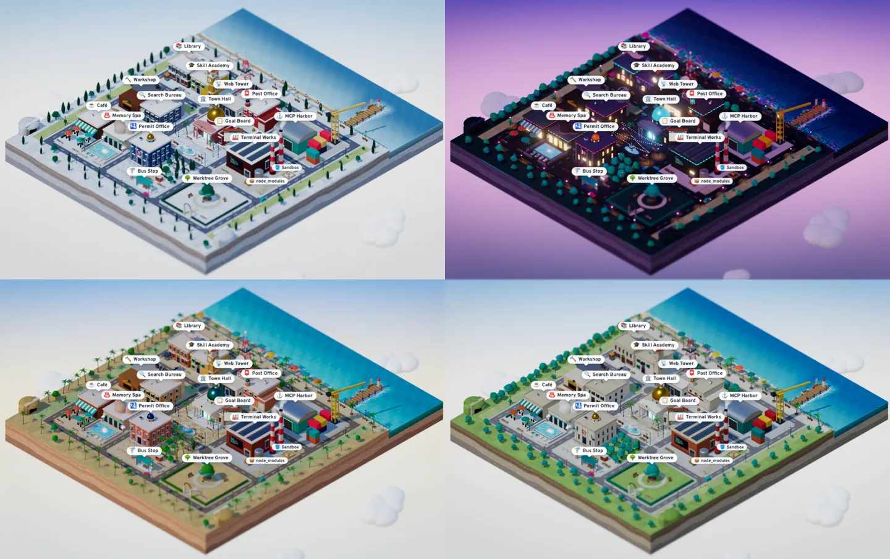
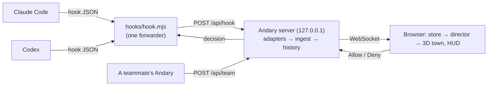

# Andary

**Watch your AI coding agents work in a living 3D town.**

Every Claude Code or Codex session on your computer moves into Andary as a crew: a Foreman (the
main agent) plus every helper it starts. When an agent reads a file it walks to the Library; when
it runs `npm test` it heads to Terminal Works; when it needs your permission it queues at the
Permit Office, and you can answer it right there. Speech bubbles say what each one is doing, with
real file names and commands (and a few jokes).



It runs entirely on your computer: no account, no cloud, no telemetry, no runtime dependencies.

**Contents:** [Install](#1-install) · [Connect Claude Code](#2-connect-claude-code) ·
[Connect Codex](#3-connect-codex) · [Use the town](#4-use-the-town) ·
[Share it](#5-share-it-with-others) · [Security](#6-security-and-privacy) ·
[Troubleshooting](#7-troubleshooting) · [CLI](#8-command-reference) ·
[How it works](#9-how-it-works) · [Development](#10-development)

---

## 1. Install

You need **Node.js 20 or newer** (22 LTS recommended), a browser with WebGL 2, and at least one of
**Claude Code** or the **Codex CLI**.

```sh
npm install -g github:eylem2002/andary    # installs the `andary` command from GitHub
```

Prefer not to install globally? Clone it and use `node cli/andary.mjs` wherever this guide says
`andary`:

```sh
git clone https://github.com/eylem2002/andary && cd andary
node cli/andary.mjs --help
```

Just curious? `andary demo` opens the town with a built-in simulation of three projects, no
agent needed.

## 2. Connect Claude Code

```sh
andary install     # adds Andary's hooks to ~/.claude/settings.json (a backup is made first)
andary start       # starts the town and opens it in your browser
```

Now use `claude` as usual, in any project; each new session arrives by bus. Sessions that were
already running pick the hooks up when they restart.

- **Only one project?** `andary install --scope local` writes
  `<project>/.claude/settings.local.json` (that project, just you). `--scope project` writes the
  shared `.claude/settings.json`, but the hook command holds an absolute path to your
  `~/.andary`, so that suits dev containers more than repositories other people clone.
- **As a plugin instead:** in Claude Code, run `/plugin marketplace add eylem2002/andary` and
  `/plugin install andary@andary`. The plugin brings its own hooks, and `/andary:town` starts and
  opens the town. Use the plugin *or* `andary install`, not both.
- **See it before it is written:** `andary install --dry-run` (or `--print` for the JSON, to
  merge by hand).
- **Agent teams** show up too; enable them in Claude Code with
  `CLAUDE_CODE_EXPERIMENTAL_AGENT_TEAMS=1`. Teammates in split panes (tmux or iTerm2) are
  separate Claude Code sessions, and their hooks carry nothing that names the lead's session,
  so each shows up as a crew of its own. The default in-process teammates join the lead's crew.

## 3. Connect Codex

Andary connects to OpenAI's **Codex CLI** through Codex's own hooks (recent versions have hooks
on by default).

```sh
andary install codex   # adds Andary's hooks to ~/.codex/hooks.json (or $CODEX_HOME/hooks.json)
andary start
```

Then start `codex`. **The first time, Codex asks you to review the new hooks: choose to trust
them** (or open `/hooks` in Codex). Untrusted hooks do not run, and the town stays empty.

- **Only one project?** `andary install codex --scope project` writes
  `<project>/.codex/hooks.json`; Codex loads it once you trust that project. (Codex has no local
  scope, and the command holds an absolute path: keep that file out of git if others clone the
  project.)
- **What you get:** Codex crews look and work like Claude Code's, with a **Codex** badge on the
  crews board and the model in their caption (for example "GPT-5.3 Codex"). Patches
  (`apply_patch`) appear as edits to each file they touch, with diffs in the inspector; commands
  that fail bring rain; helpers that Codex starts join the crew; and remote approvals work the
  same way.
- **Not yet:** Codex's token costs. The cost meter reads Claude Code's transcripts only.

Using both? Install both. Each agent's events arrive marked with where they came from, so one
town shows them all side by side.

### Check that it works

```sh
andary status    # is the server running, and where are the hooks installed (both agents)
andary doctor    # sends a test event through the real forwarder and checks it reached the town
```

To undo: `andary uninstall` (Claude Code) or `andary uninstall codex` removes exactly the hooks
Andary added and nothing else.

## 4. Use the town

`andary start` prints a sign-in link and opens it. The link holds a private token, so don't share
it; the page keeps it for this town only (no other site or local server can read it) and takes it
out of the address bar. Other tabs on the same town are signed in too.

### What the buildings mean

| Building | Agents go there to… | Tools |
| --- | --- | --- |
| Town Hall | start a crew, spawn helpers (through a glowing portal) | `Agent`, Codex `spawn_agent` |
| Library | read files | `Read` |
| Workshop | edit and write files | `Edit`, `Write`, `NotebookEdit`, Codex `apply_patch` |
| Terminal Works | run shell commands; `npm install` grows the node_modules pile | `Bash`, `PowerShell` |
| Search Bureau | grep and glob through code | `Grep`, `Glob` |
| Web Tower | search and fetch the web | `WebSearch`, `WebFetch`, `curl` |
| Goal Board | update todo lists and team tasks (shown live on the billboard) | `TodoWrite`, `Task*` |
| Post Office | message teammates, commit and push (the mail truck leaves) | `SendMessage`, `git commit/push` |
| MCP Harbor | use tools from MCP servers (boats come in) | `mcp__*` |
| Permit Office | wait for your approval | permission prompts |
| Memory Spa | relax while their context is compacted | compaction |
| Skill Academy | load skills | `Skill` |
| Café | wait for your next prompt (and fall asleep if you take too long) | idle |
| Worktree Grove | grow a tree per git worktree | worktrees |
| Bus Stop | arrive and leave | session start and end |

Each building carries a small sign: its icon, and its name when there is room for it (zoom in to
see more names, or press `P`). Signs fade while an agent stands in front of them, so they never
hide anyone. Hats show the model (a crown for Opus, a beret for Sonnet, a sun hat for Haiku, a cap
for OpenAI models). Click any agent for its details, including a diff of every file it changed, or any
building to see who is inside.

### Keyboard

| Key | Does |
| --- | --- |
| `C` | Director camera on or off: it follows the most interesting thing by itself |
| `H` | Full-screen town: put the side boards away or bring them back |
| `F` / `Esc` | Follow the selected agent / stop following, close the open panel |
| `[` `]` · `+` `−` · `0` | Rotate · zoom · reset the view |
| `N` | Day, sunset, night or your clock |
| `P` | Place names: on the buildings where they fit (zoom in for more), always, or off |
| `M` | Sound on or off |
| `U` · `L` | Usage (tokens and estimated cost) · Leaderboard |
| `I` | Go to what needs you, most urgent first (again for the next) |
| `A` | Go to approvals |
| `1`–`9` | Jump to crew 1 to 9 |
| `?` | All shortcuts |

### Answer permission prompts from the town

Off by default. Turn on **Remote approvals** in Settings (or start with
`andary start --remote-approvals`). A permission request then gets **Allow** and **Deny** buttons
and a countdown; if nobody answers within two minutes, the normal prompt appears in your
terminal. The card shows the exact request, and for a file change the change itself: a new
file's content, or an edit as a diff. Anything that draws nothing (an unusual space, a
zero-width or direction mark, a run of blank lines) shows as a marker such as `⟨U+00A0⟩`, so
nothing can hide in what you approve. To tell the agent why you said no, type a reason before
**Deny** (or press Enter in the reason field). When Claude Code suggests a rule for the request,
**Allow always** also asks it to save that rule for this project (only you) or for the session,
and the card shows the exact rule first, such as `Bash(npm run build)`, with what it allows in
words. Only a rule the card can say exactly is offered: one command, Bash commands starting with a
prefix, fetches from one web host, or one MCP tool. A request the town cannot show in full (a
secret was masked, a long value was cut, or it has an option the card does not show, such as
running a command outside the sandbox) is never held there and goes straight to your terminal; so
does one from an older copy of Andary's hook (the card says how to update it). Codex does not say
whether a command asks to leave its sandbox, so a Codex command's card says that allowing it may.

### See what needs you

When an agent stops for you (a permission request, a question, a plan to approve, a turn that
stopped on an error, or a finished turn nobody answered for a minute), its row in **Crews** says
what for and how long it has waited, the browser tab reads **(2) Andary**, and a **2 need you**
button sits at the top right: yellow while an agent is blocked or stopped, quieter when crews only
finished their turns. Click it (or press `I`) to go to the most urgent: a request the town can
answer opens its card in Approvals, anything else selects the agent; click again for the next.
A stop or a finished turn can be set aside from its row or the agent's details, and so can a
request still waiting after five minutes, in case it is stale. With
notifications on (Settings), each new one also pops up while the tab is in the background.

### Everything else

- **Cost and tokens:** each crew shows what it has cost so far, estimated at API list prices from
  Claude Code's own transcripts (on a Pro or Max plan, a measure of value, not a bill). `U` opens
  today's total and the last 14 days.
- **Weather:** rain when commands fail, a storm when they keep failing, a rainbow when tests pass
  again, fog while a crew thinks for a long time.
- **The town grows:** finished turns and tasks earn points, and points build landmarks, from
  bunting at 10 to a golden dome on the Town Hall at 500. `L` shows how far the town has come.
- **Town looks:** Settings → Town look: the sunset coast, a snowy village, a neon city, a desert
  oasis or Amman's old town.
- **Sound:** `M` turns on sound effects and a soundscape (waves, gulls or crickets, a city hum,
  soft chords that follow the work).
- **Notifications:** on this computer (Settings, while the tab is in the background), or on your
  phone with `andary start --notify` through the free [ntfy](https://ntfy.sh) app, no account.
  Phone messages say only what happened ("A crew needs your permission"), never your project,
  files or commands. A note for a permission request, a question, a plan or an MCP server's form
  waits ten seconds, and none is sent if Andary sees the answer first: a decision in the town, the
  tool finishing after your answer in the terminal, or your next prompt. Andary sees a yes for a
  longer command only when it finishes, and a "No" only at your next prompt, so those can still
  send one.



## 5. Share it with others

### A shared team town

Several people's agents in one town, live. One person hosts; everyone else shares into it.

**On the host's computer:**

```sh
andary start --team                # listens on your network (it warns you)
andary team invite Lina            # prints two lines to send Lina, privately
```

**Lina gets two lines.** The first shares her sessions (she installs Andary and connects her
agent as in sections 1–3, then runs):

```sh
ANDARY_TEAM_KEY=Lina.xxxxxxxx andary start --share-to http://192.168.1.20:4747
```

The second is a **view-only link** to watch the shared town in a browser. Lina's crews arrive in
the host's town with her name on their Foreman and a badge on the crews board.

What is shared and what is not:

- **Shared:** the events of her sessions (prompts, commands, file paths, edits), already
  sanitized by her own Andary. Whoever has the view link sees every crew in the town, the
  host's too, so keep it within the team.
- **Not shared:** costs (they stay on each computer), phone notifications, and control: each
  person answers their own permission prompts, and viewers cannot change anything.
- **Network:** plain HTTP unless you give the host a certificate (below), so only on a network
  you trust. Across the internet, use a private network such as Tailscale and start the host
  with `--team-host <its-vpn-name>` so the link works at that name.
- **Encrypted (HTTPS):** start the host with a certificate for the name teammates use, for
  example one from `tailscale cert` (free on Tailscale):

  ```sh
  tailscale cert my-laptop.tailnet.ts.net
  andary start --team --team-host my-laptop.tailnet.ts.net \
    --tls-cert my-laptop.tailnet.ts.net.crt --tls-key my-laptop.tailnet.ts.net.key
  ```

  Other computers must then use `https://`: the invite and the view link say so, and plain
  HTTP is refused from the network. Your own computer keeps using plain HTTP on `127.0.0.1`,
  which never leaves it. A self-signed certificate works too if every teammate trusts it
  (`NODE_EXTRA_CA_CERTS=<cert> andary start --share-to …`, and in their browser).
- **Revoke:** `andary team reset` on the host invalidates every key and the view link.

### A demo anyone can open

The `public/` folder is a complete static site: without an Andary server behind it, it plays the
built-in simulation. Serve that folder from any static host and share the link: for example
GitHub Pages with a Pages workflow that uploads `public/` (a branch can only publish its root or
`docs/`), or Netlify or Cloudflare Pages pointed at `public/`. Nothing of yours is in it.

### A recording of a real session

```sh
andary start --record              # writes every (sanitized) event to ~/.andary/recordings/
andary replay recording.jsonl      # plays it back into a running town (--speed 4 for 4×)
```

A recording holds the prompts and commands of that session (secrets are redacted), so read it
before you send it to anyone.

### The project itself

Point people to the repository: `npm install -g github:eylem2002/andary`, or the Claude Code
plugin (`/plugin marketplace add eylem2002/andary`).

## 6. Security and privacy

Andary sees what your agents see, so it is locked down:

- the server listens on `127.0.0.1` only (unless you choose `--host` or host a team town), checks
  the `Host` header (DNS rebinding) and the WebSocket `Origin` (cross-site hijacking);
- browsers sign in with a random per-start token that the page keeps for its own address only
  and sends with each request; there is no cookie, which would also reach every other local
  server on `127.0.0.1` (ADR 0015); hooks use a separate secret; both live in
  `~/.andary/server.json`, readable only by you;
- the hook forwarder only talks to a live server of yours that first proves it holds a key that
  never leaves `~/.andary`, and only obeys replies signed with it, so a stale state file cannot
  hand your prompts, the hook secret or control of your agent to whoever takes the old port;
- secrets that look like API keys, tokens or passwords are redacted before anything is kept or
  sent; prompts and commands are never written to disk unless you pass `--record` (small state
  files in `~/.andary` keep usage totals with the transcript paths they came from, and the
  town's points);
- a strict Content-Security-Policy, no third-party requests (fonts and three.js are bundled), and
  no event text is ever rendered as HTML;
- the installer keeps a backup of every file it changes and writes through temporary files it
  creates itself, so a link planted in a project's `.claude/` folder is never followed.

Known limits and what to do about them: [final report, section 5](docs/FINAL-REPORT.md#5-remaining-risks).
The full model: [docs/INTEGRATION.md](docs/INTEGRATION.md).

## 7. Troubleshooting

| Problem | Try |
| --- | --- |
| The town stays empty | `andary doctor`. It names the broken step and the fix. Restart agent sessions that were running before you installed. |
| Codex sessions don't show up | Start `codex` and trust Andary's hooks when it asks (or open `/hooks`); `andary status` should list "Codex, user scope: installed". |
| "Sign in with the link…" | The server restarted with a new token: use the link `andary start` printed, or `andary status` to see it again. |
| Port 4747 is in use | `andary start --port 5000` (or `--port 0` for any free port). |
| Events arrive twice | The plugin and `andary install` are both active, or one agent is installed in two scopes: `andary doctor` says which; uninstall one. |
| A teammate's view link says "Forbidden" | Start the host with `--team-host <the name in the link>`, or use the IP address the invite printed. |
| The 3D view is blank or slow | Settings → Graphics → Low power; the boards and log keep working without WebGL. |

## 8. Command reference

```
andary [command] [options]

  start                 start the town and open it (the default command)
                        --port <n>, --host <address>, --no-open, --detach, --record,
                        --remote-approvals, --approval-timeout <s>, --notify, --notify-url <url>,
                        --team [--team-host <name>], --share-to <address> (key in ANDARY_TEAM_KEY),
                        --tls-cert <file> --tls-key <file> (HTTPS for other computers)
  demo                  start the town with the built-in simulation
  stop                  stop the running town
  install [codex]       add the hooks for Claude Code (default) or Codex
                        --scope user|project|local, --dir <path>, --dry-run, --print
  uninstall [codex]     remove exactly the hooks Andary added
  team invite <name>    on a team host: a teammate's key and the view link (--url <address>)
  team reset            on a team host: revoke every key and the view link
  status                server, sign-in link, hooks per agent and scope
  doctor                check the whole pipeline end to end
  simulate              send simulated sessions to the running town (--speed, --seed)
  replay <file.jsonl>   play back a recording made with --record (--speed)
```

Environment: `ANDARY_HOME` (default `~/.andary`), `ANDARY_PORT` (default 4747),
`CLAUDE_CONFIG_DIR` (default `~/.claude`), `CODEX_HOME` (default `~/.codex`),
`ANDARY_NOTIFY_URL`, `ANDARY_SHARE_TO`, `ANDARY_TEAM_KEY`, `ANDARY_TLS_CERT`, `ANDARY_TLS_KEY`.

## 9. How it works



- **Hooks:** both agents run the same small forwarder for each event; observation hooks are
  asynchronous, so they never slow your agent down. A permission request waits for the town only
  when remote approvals are on; a session's end (and Codex's Interrupt) waits at most a moment
  while the forwarder hands it over.
- **Server:** Node built-ins only. Every source is translated into one event format at the edge,
  then one pipeline sanitizes it, keeps the last 2,000 events in memory for newly opened tabs and
  sends it to the browsers.
- **Browser:** plain ES modules and three.js, no build step. A store keeps the state, a director
  turns it into who walks where, and the HUD and the 3D world render it. The demo feeds the same
  pipeline.

The full design, its layer rules and where to find things: [docs/ARCHITECTURE.md](docs/ARCHITECTURE.md).
Exact interfaces: [docs/CONTRACTS.md](docs/CONTRACTS.md). Decisions: [docs/adr/](docs/adr/README.md).

## 10. Development

```sh
npm ci                                 # dev tools only; the app has no runtime dependencies
npx playwright install chromium        # browser for the end-to-end tests
npm run hooks:install                  # fast checks before every git push
npm run demo                           # or: npm start
```

| Command | What it runs |
| --- | --- |
| `npm run lint` | ESLint, zero warnings allowed |
| `npm run lint:config` | JSON, shellcheck, actionlint, yamllint |
| `npm run typecheck` | `tsc --checkJs` over all sources |
| `npm run deadcode` | exports that nothing imports |
| `npm run boundaries` | the layer rules (core is pure, the HUD never imports the 3D world, …) |
| `npm test` | unit + integration tests (`node:test`) |
| `npm run test:e2e` | Playwright end-to-end and axe accessibility suites, desktop + mobile |
| `npm run perf` | Lighthouse, desktop + mobile |
| `npm run licenses` | licence allow-list over every installed package and vendored asset |
| `npm run secrets` | secret scan of the working tree and the full git history |
| `npm run check:fast` | all of the above except audit, e2e and Lighthouse (the pre-push hook) |
| `npm run check` | everything, end-to-end and accessibility included |

Handy pages: `/world-lab.html` (characters and effects), `/world-env-lab.html` (the town),
`?demo=1&speed=4&world=fake` for HUD-only work. Containers without Playwright's browser can use
an installed Chrome: `CHROME_PATH=/usr/bin/google-chrome npm run check`.

GitHub Actions ([ci.yml](.github/workflows/ci.yml)) runs the same checks on every pull request
on Linux, and the unit and integration tests on macOS and Windows
(free on public repositories); Dependabot keeps dependencies and pinned actions current.

### Project layout

```
cli/andary.mjs        CLI entry (not bin/: plugin hosts put a plugin's bin/ on the PATH)
server/               HTTP + WebSocket server, auth, approvals, sanitizing, team town
server/adapters/      Claude Code and Codex → one event format
server/ingest.mjs     the one pipeline every event enters through
server/cli/           one module per command
hooks/                the hook forwarder (shared by Claude Code and Codex) and plugin hooks
public/js/core/       pure logic: events, store, director, catalog, rules shared with the server
public/js/sources/    where events come from: live (WebSocket) or demo (simulation)
public/js/ui/         the HUD
public/js/world/      the 3D town (env/), its people (agents/), and the world facade
public/js/sim/        the simulation (demo mode and `andary simulate`)
test/unit/…           unit tests, mirroring the source tree; test/integration/, e2e/
docs/                 architecture, contracts, ADRs, reviews, owner setup
```

### Documentation

- [Architecture](docs/ARCHITECTURE.md) · [Contracts](docs/CONTRACTS.md) · [ADRs](docs/adr/README.md)
- [Integration and security model](docs/INTEGRATION.md) · [Assumptions](docs/ASSUMPTIONS.md)
- Reviews: [security](docs/reviews/security-review-2026-11-17.md),
  [code quality](docs/reviews/code-quality-review-2026-11-17.md),
  [architecture](docs/reviews/architecture-review-2026-11-20.md),
  [features](docs/reviews/feature-review-2026-11-20.md)
- [Owner setup](docs/OWNER-SETUP.md) · [Final report](docs/FINAL-REPORT.md)

## License

[MIT](LICENSE). three.js (MIT) and the Overpass fonts (SIL OFL 1.1) are bundled; see
[THIRD_PARTY_NOTICES.md](THIRD_PARTY_NOTICES.md).
