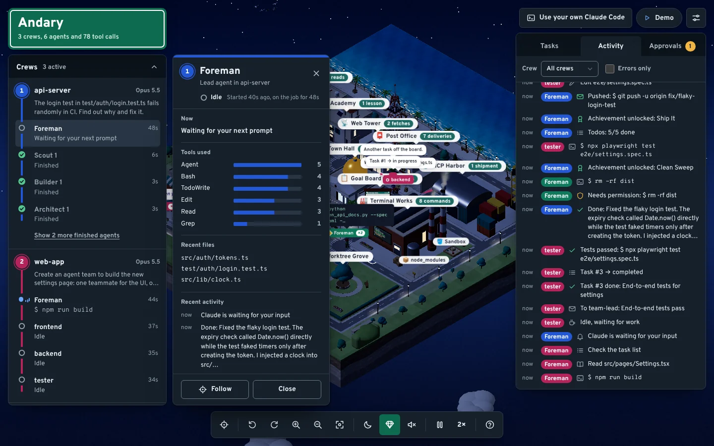
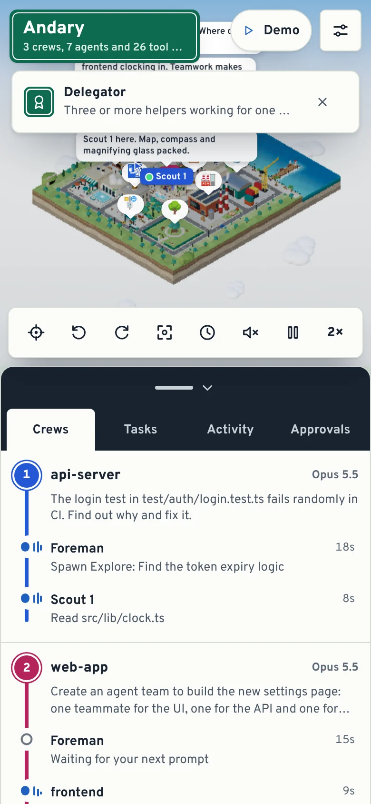
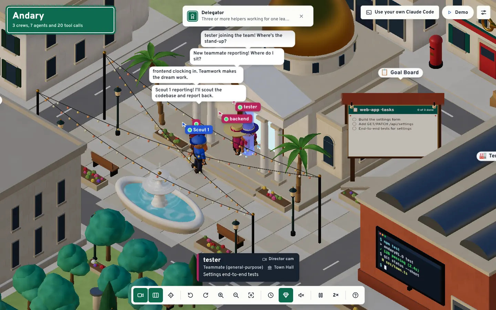
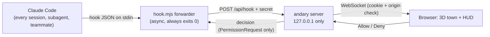

# Andary

**Watch your Claude Code agents work in a living 3D town.**

Every Claude Code session on your machine moves into Andary as a crew: a Foreman (the main
agent), plus every subagent and agent-team teammate it spawns. When an agent reads a file it
walks to the Library; when it runs `npm test` it heads to Terminal Works; when it needs your
permission it queues at the Permit Office, and you can approve it right there. Speech bubbles
tell you what each one is doing (with jokes, but mostly with real file names and commands).






It runs entirely on your machine: no account, no cloud, no telemetry, no runtime dependencies.
(Phone notifications are opt-in and go through the free ntfy service; see below.)

## Quick start

You need **Node.js 20+** (22 LTS recommended), **Claude Code**, and a browser with WebGL 2.

```sh
npm install -g github:eylem2002/andary   # installs the `andary` command straight from GitHub
andary install                           # adds hooks to ~/.claude/settings.json (backup made)
andary start                             # starts the town and opens it in your browser
```

Now use `claude` as usual, in any project. The town fills up as your agents work.

- No Claude session handy? `andary demo` plays a built-in simulation of three projects.
- Changed your mind? `andary uninstall` removes exactly the hooks it added.
- Prefer a clone? `git clone https://github.com/eylem2002/andary && cd andary`, then use
  `node bin/andary.mjs <command>` instead of `andary <command>`.
- As a Claude Code plugin: `/plugin marketplace add eylem2002/andary`, then
  `/plugin install andary@andary`; the plugin brings its own hooks, and `/andary:town` starts
  and opens the town (see [docs/INTEGRATION.md](docs/INTEGRATION.md)).

## What you'll see

| Building | Agents go there to… | Tools |
| --- | --- | --- |
| Town Hall | start a crew, spawn subagents (through a glowing portal) | `Agent` (`Task`) |
| Library | read files | `Read` |
| Workshop | edit and write files | `Edit`, `Write`, `NotebookEdit` |
| Terminal Works | run shell commands; `npm install` grows the node_modules pile | `Bash`, `PowerShell` |
| Search Bureau | grep and glob through code | `Grep`, `Glob` |
| Web Tower | search and fetch the web | `WebSearch`, `WebFetch`, `curl` |
| Goal Board | update todo lists and team tasks (shown live on the billboard) | `TodoWrite`, `Task*` |
| Post Office | send messages to teammates, commit and push (the mail truck leaves) | `SendMessage`, `git commit/push` |
| MCP Harbor | use tools from MCP servers (boats come in) | `mcp__*` |
| Permit Office | wait for your approval | permission prompts, `AskUserQuestion` |
| Memory Spa | relax while their context is compacted | compaction |
| Skill Academy | load skills | `Skill` |
| Café | wait for your next prompt (and fall asleep if you take too long) | idle |
| Worktree Grove | grow a tree per git worktree | worktrees |
| Bus Stop | arrive and leave | session start and end |

Also: hats show the model (crown for Opus, beret for Sonnet, sun hat for Haiku), failing tests
bring a personal rain cloud, rate limits a thunderstorm, passing tests fireworks, and there are
achievements to unlock ("Red to Green", "node_modules Black Hole", "Night Shift"…). The town
is a sunset coast (pastel stucco, palms, a beach, neon at dusk) that follows your clock, or press
`N` for day, sunset or night. Click any agent for its details, including a diff of every file
it changed, or any building for who is inside.

### Town looks

Settings → **Town look** rebuilds the whole town, its sky and its sea in another style: the
sunset coast, a snowy village (where the rain falls as snow and snowmen stand on the shore), a
neon city whose lights never quite go out, a desert oasis, or the limestone of Amman's old town.


### The town grows with you

Every finished turn, finished helper and completed task is a point, and points unlock
landmarks: bunting over the avenue at 10, an ice-cream cart at 25, a curly-brace statue at 50, a
Ferris wheel on the beach at 100, a hot-air balloon at 200 and a golden dome on the Town Hall at
500. The count is kept across restarts. `L` (or the trophy) opens the **Leaderboard**: how far
the town has grown, your busy-day streak, the fastest fix and who turned the most test runs
green, and the busiest agents in town.

### Notifications

Settings → **Notifications on this computer** pings you while the town is in a background tab:
a crew needs your permission, finished its turn or stopped with an error. For your **phone**,
start with `andary start --notify`: Andary makes a private, random topic on the free
[ntfy](https://ntfy.sh) service (no account), prints its address, and you subscribe to it in the
ntfy app. Phone messages only say what happened ("A crew needs your permission"), never your
project, files or commands, and at most one of a kind every 30 seconds. `--notify-url` points
at your own ntfy server instead; Settings has a test button.

### Team town

Several people's sessions in one town. One of you hosts with `andary start --team`; for each
teammate, run `andary team invite <name>` on that computer and send them the two lines it
prints: an `andary start --share-to … --team-key …` command that shares their sessions, and a
view-only link to watch the shared town. Teammates' crews arrive with their name on the foreman
and a badge on the crews board. Only events travel: costs stay on each computer, and each person
answers their own permission prompts. It is plain HTTP for a network you trust (across the
internet, use a private network such as Tailscale); `andary team reset` revokes every key and
the link.

### Ambient sound

With sound on (`M`), the town has its own soundscape, all synthesised in the browser: waves on
the shore, gulls by day and crickets by night, a city hum and soft chords that get fuller as the
crews get busier, and rain when the town's weather rains. It fades out when the tab is in the
background; Settings → Ambient sound turns it off and keeps the effects.

### Weather

The town's weather follows the work: rain when commands fail, a storm with lightning when they
keep failing or a turn fails, a rainbow when tests pass again, fog while a crew has been
thinking for a long time. Turn it off in Settings.

### Cost and tokens

Each crew shows what it has cost so far, and `U` (or a crew's cost) opens **Usage**: today's
total and the last 14 days as a chart. Andary reads the token counts from Claude Code's own
transcripts on your computer and prices them at the API list prices, so on a Pro or Max plan it
is an estimate of value, not a bill. The agent inspector shows each agent's tokens too.

### Director camera and full-screen town

Leave the camera alone and a director takes it. It follows whoever is doing the most interesting
thing right now (a new subagent arriving, a permission prompt, a failing command, a message to a
teammate) in close-up, pulls back for a wider shot every few cuts, and a caption says who is on
screen and what they are doing. Select an agent, drag, zoom or rotate and it stands back; after
20 quiet seconds it carries on. `C` turns it off or on (it starts off if you have asked for
reduced motion), and `H` puts the side boards away so the town fills the screen (both are also on
the toolbar). A demo on a static host opens this way.



## Approve permission prompts from the town

Off by default. Turn on **Remote approvals** in Settings (or start with
`andary start --remote-approvals`). When Claude Code asks for permission, the card in the
Approvals tab gets **Allow** and **Deny** buttons and a countdown; if nobody answers within
two minutes the normal terminal prompt appears. With it off, the town still shows each request
so you know who is waiting.

Approval cards show the exact request (the full path, every MCP argument, and any invisible or
text-reversing characters made visible). A request the town cannot show in full, because a
secret was masked or a long value was cut, is never held: it goes straight to your terminal.
Allow and Deny ignore clicks for a second after a card appears or moves, so a new request
cannot catch a click meant for another; the keyboard is never delayed.

## How it works



- **Hooks**: `andary install` registers a tiny forwarder for 19 hook events. Observation hooks
  run with `"async": true`, so they never slow Claude down; only `PermissionRequest` waits, and
  only when remote approvals are on.
- **Server**: Node built-ins only. Sanitises and redacts every payload, keeps the last 2,000
  events in memory for newly opened tabs. On disk it keeps only numbers and dates in `~/.andary`
  (tokens and cost per day, the town's growth); prompts and commands are written only if you
  pass `--record`.
- **Browser**: plain ES modules and three.js, no build step. The same pipeline runs the demo.

Design notes and interfaces: [docs/CONTRACTS.md](docs/CONTRACTS.md) and
[architecture decision records](docs/adr/README.md).

## Security and privacy

Andary sees what your agents see (prompts, commands, file paths), so it is locked down:

- listens on `127.0.0.1` only (unless you choose `--host` or host a team town), and checks the `Host` header (DNS rebinding) and the WebSocket
  `Origin` (cross-site hijacking);
- the browser signs in with a random per-start token, exchanged for an `HttpOnly`,
  `SameSite=Strict` cookie; hooks authenticate with a separate secret; both live in
  `~/.andary/server.json`, readable only by you;
- strict Content-Security-Policy, no third-party requests (fonts and three.js are bundled), and
  event text is never rendered as HTML;
- secrets that look like API keys, tokens or passwords are redacted before anything leaves the
  server; nothing you or Claude wrote is logged or written to disk by default;
- the hook forwarder only talks to a live server of yours, and only obeys replies signed with a
  per-start key that never leaves `~/.andary` (a stale state file cannot hand your prompts, or
  control of Claude Code, to whoever grabs the old port);
- the installer refuses symlinked settings files, and the state folder must belong to you.

Known limits, with what to do about them, are in the
[final report](docs/FINAL-REPORT.md#5-remaining-risks).

Details: [docs/INTEGRATION.md](docs/INTEGRATION.md) and the
[security review](docs/reviews/security-review-2026-11-17.md).

## CLI

```
andary [command] [options]

  start                 start the town and open it (default). --port, --host, --no-open,
                        --remote-approvals, --approval-timeout <s>, --notify, --notify-url <url>,
                        --team, --share-to <address> --team-key <key>, --record, --detach
  demo                  start the town in demo mode
  stop                  stop the running town
  install / uninstall   add or remove the hooks. --scope user|project|local, --dir, --dry-run, --print
  team invite <name>    on a team host: a teammate's key and the view link (--url <address>)
  team reset            on a team host: revoke every key and the view link
  status                server, sign-in link, hooks per scope
  doctor                check the whole pipeline end to end
  simulate              send simulated sessions to the running town (--speed, --seed)
  replay <file.jsonl>   replay a recording made with --record (--speed)
```

Environment: `ANDARY_HOME` (default `~/.andary`), `ANDARY_PORT` (default 4747),
`CLAUDE_CONFIG_DIR` (default `~/.claude`). Agent teams need
`CLAUDE_CODE_EXPERIMENTAL_AGENT_TEAMS=1` in Claude Code.

## Development

```sh
npm ci                                 # dev tools only
npx playwright install chromium        # browser for the end-to-end tests
npm run hooks:install                  # fast checks before every git push
npm run demo                           # or: npm start
```

| Command | What it runs |
| --- | --- |
| `npm run lint` | ESLint, zero warnings allowed |
| `npm run lint:config` | JSON, shellcheck, actionlint, yamllint |
| `npm run deadcode` | exports that nothing imports (`scripts/find-unused-exports.mjs`) |
| `npm run typecheck` | `tsc --checkJs` over all sources |
| `npm test` | unit + integration tests (`node:test`) |
| `npm run test:e2e` | Playwright end-to-end and axe accessibility suites, desktop + mobile |
| `npm run perf` | Lighthouse, desktop + mobile |
| `npm run licenses` | licence allow-list over every installed package and vendored asset |
| `npm run secrets` | secret scan of the working tree and the full git history |
| `npm run check` | **everything above** (the full local check) |
| `npm run check:fast` | lint, config lint, typecheck, dead code, tests, licences, secrets (the pre-push hook) |

Containers without Playwright's browser can use an installed Chrome:
`CHROME_PATH=/usr/bin/google-chrome npm run check`.

Handy pages while hacking: `/world-lab.html` (characters and effects) and
`/world-env-lab.html` (the town itself); `?demo=1&speed=4&world=fake` for HUD-only work.

### Continuous integration

GitHub Actions ([.github/workflows/ci.yml](.github/workflows/ci.yml)) runs on every pull request
and on `main`: audit, lint, config lint, typecheck, dead code, tests, licences and a
full-history secrets scan on Node 22 and 24, then the end-to-end and accessibility suites. It is
free on public repositories (and about 10 of the 2,000 free minutes per push on private ones).
Dependabot keeps dependencies and pinned actions current.

Before every push, the pre-push hook (`npm run hooks:install`, once per clone) runs the same fast
checks locally; `npm run check` runs everything, end-to-end and accessibility included.

### Deploying

Andary is a local tool, so there is nothing to deploy for normal use. To host the demo, serve the
`public/` folder from any static host: without a server it runs the simulation automatically.

## Project layout

```
bin/andary.mjs        CLI
server/               HTTP + WebSocket server, auth, approvals, sanitising, installer
hooks/                hook forwarder and plugin hook config
public/js/core/       hook normalisation, store, director, humour
public/js/world/      3D town (env/), characters (agents/), world facade
public/js/ui/         HUD
public/js/sim/        simulation (demo mode and `andary simulate`)
test/, e2e/           node:test and Playwright suites
docs/                 contracts, ADRs, QA and security reports, owner setup
```

## Documentation

- [Owner setup](docs/OWNER-SETUP.md): the few things that need you
- [Integration and security model](docs/INTEGRATION.md)
- [Architecture contracts](docs/CONTRACTS.md) and [ADRs](docs/adr/README.md)
- [Assumptions](docs/ASSUMPTIONS.md)
- [QA checks](docs/qa/checks-2026-11-17.md), [security review](docs/reviews/security-review-2026-11-17.md),
  [code-quality review](docs/reviews/code-quality-review-2026-11-17.md)
- [Final report](docs/FINAL-REPORT.md)

## License

[MIT](LICENSE). three.js (MIT) and the Overpass fonts (SIL OFL 1.1) are bundled; see
[THIRD_PARTY_NOTICES.md](THIRD_PARTY_NOTICES.md).
